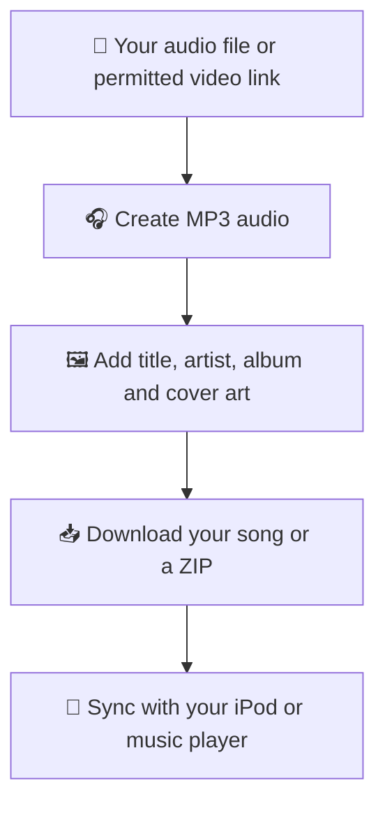

# 🎵 My pod promax — by Bipzilla

Your pocket music organiser: take **your own audio** or **video links you have permission to save**, make MP3s, organise song names and album art, then download your music for an iPod or other player.

## What does the app do?



## Start it from VS Code, CMD, PowerShell or Terminal

**Yes — all of these work.** Open the project folder in VS Code and choose **Terminal → New Terminal**, or open a Windows Command Prompt/PowerShell, Mac Terminal or Linux terminal. The same `app.py` runs everywhere.

### Get the app from GitHub

```bash
git clone https://github.com/RAMEY031116/my-pod-promax.git
cd my-pod-promax
```

You can instead choose **Code → Download ZIP** on GitHub, extract it, and open the extracted folder in your terminal. You need Python 3.10+ and FFmpeg installed separately.

### Easy start for your operating system

| Computer | Run in the project folder |
|---|---|
| **Mac / VS Code** | `zsh start_mac.sh` |
| **Windows Command Prompt** | `start_windows.bat` |
| **Windows PowerShell / VS Code** | `.\\start_windows.bat` |
| **Linux / VS Code** | `bash start_linux.sh` |

The launcher creates a project-specific Python environment and installs Python packages. On first run, give it time to finish installation; then open **http://localhost:8501**. Keep the terminal open while using the app. Press **Ctrl+C** to stop.

### Prefer launching app.py directly with Streamlit?

Install the Python requirements once, then run the app using **Streamlit**, not `python app.py`.

**Mac/Linux**:
```bash
python3 -m venv .venv
source .venv/bin/activate
python -m pip install -r requirements.txt
python -m streamlit run app.py
```

**Windows PowerShell or CMD** (no activation needed):
```powershell
py -3 -m venv .venv
.\\.venv\\Scripts\\python.exe -m pip install -r requirements.txt
.\\.venv\\Scripts\\python.exe -m streamlit run app.py
```

**FFmpeg:** Mac with Homebrew: `brew install ffmpeg`. Windows with winget: `winget install Gyan.FFmpeg`. Ubuntu/Debian Linux: `sudo apt install ffmpeg`. Restart your terminal and confirm using `ffmpeg -version`.

**Streamlit Cloud:** Deploy `app.py` from this repository; `requirements.txt` installs Python packages and `packages.txt` installs FFmpeg on the hosted Linux server. YouTube may reject downloads from hosted server IPs. The Cloud's storage is separate from your PC.

## Everyday use

1. Search for a musician or album, or import your own audio.
2. Paste permitted video links or upload audio files.
3. Check song names, artists and artwork.
4. Make the MP3 files and download tracks individually or as a ZIP.
5. Sync the finished files with the iPod's music-management software if you want cover art to appear.

Only use recordings you are allowed to download. Private/restricted videos cannot be guaranteed to work.

## Quick fixes

- **No space left on device:** Free storage and try a small batch. ZIP creation temporarily needs additional space.
- **FFmpeg not found:** Install FFmpeg for your system and reopen the terminal.
- **HTTP 403 / blocked IP:** The video provider may be denying the host/network access. Try an authorised local upload. Delays do not bypass restrictions.
- **Missing artwork on an older iPod:** Check artwork in your music manager, then resync the song. Simply dragging an MP3 into an iPod storage folder may not populate its artwork database.
- **ModuleNotFoundError:** Use the launcher or install `requirements.txt` using the same Python executable used to run Streamlit.

---

## Additional project notes


A pink, iPod-inspired music organiser created **by Bipzilla**. Import your own audio files or links you are authorised to download, convert audio to MP3, organise track metadata, and embed available cover art. No account or API key is required.

## 1. What you need

- A Mac, Windows PC, or Linux computer.
- **Python 3.10 or newer**. On a Mac, install a current Python from [python.org](https://www.python.org/downloads/) if necessary.
- **FFmpeg** to convert audio. On a Mac with Homebrew, run `brew install ffmpeg`; on Windows, run `winget install Gyan.FFmpeg` and reopen your terminal; on Ubuntu, run `sudo apt install ffmpeg`.
- Internet access for catalogue searches, permitted links, and online artwork.

Check FFmpeg by running `ffmpeg -version` in a terminal. If it says command not found, install FFmpeg before continuing.

## 2. Install and start on macOS — recommended

1. Download the ZIP and **extract it**. Inside is a folder named exactly **`My pod promax`**.
2. Open the **Terminal app** or **VS Code → Terminal → New Terminal**.
3. Drag the extracted **My pod promax** folder from Finder into the Terminal after typing `cd ` (including the space), then press Enter. Alternatively, if it is in Downloads, paste:

   ```bash
   cd ~/Downloads/"My pod promax"
   ```

4. Start it with:

   ```bash
   chmod +x start_mac.sh
   ./start_mac.sh
   ```

5. The script creates `.venv`, installs the Python packages and launches Streamlit. Open **http://localhost:8501** if the browser doesn't open automatically.
6. **Leave Terminal open** while you use the site. Press **Control+C** to stop it. Next time, repeat steps 3–4.

**Important:** Do *not* run `/usr/bin/python3 app.py`. macOS system Python may not have `mutagen`, and launching `app.py` directly isn't the supported way to run Streamlit. The Mac script always uses the correct `.venv` Python.

If your folder is named `My pod promax 2` or similar, either rename it to `My pod promax` in Finder or use the drag-and-drop method in step 3. **If Terminal reports `start_mac.sh: No such file`, run `pwd` and `ls` to confirm that you're inside the folder containing `start_mac.sh`, `app.py` and `requirements.txt`.**

## 3. Start on Windows

1. Extract the ZIP and open PowerShell inside **My pod promax** (the folder containing `app.py`).
2. Run:

   ```powershell
   py -m venv .venv
   .\.venv\Scripts\python.exe -m pip install -r requirements.txt
   .\.venv\Scripts\python.exe -m streamlit run app.py
   ```

3. Open http://localhost:8501. Press **Ctrl+C** in PowerShell to stop the app.

## 4. Start on Linux

Open a terminal in the extracted **My pod promax** folder, then:

```bash
python3 -m venv .venv
./.venv/bin/python -m pip install -r requirements.txt
./.venv/bin/python -m streamlit run app.py
```

## 5. Use the application

**Import a song or a batch**

1. Open **Import audio / links**.
2. Paste one or more links (one per line), upload a `.txt` file of links, or upload audio files.
3. Optionally choose **Preview video information**, then select the songs and edit artist, title or album.
4. Choose **Process selected songs**. Audio is converted to MP3 and available metadata/artwork is embedded in ID3 tags.
5. Open **Your library** and download MP3 files individually or prepare a ZIP of the library.

**Discover albums and artists**

1. Open **Discover music** and select **Album** or **Artist**.
2. Search, choose a result, and for artists click **Browse artist releases**.
3. Select an album and **Show album tracklist**.
4. Expand the tracks you want, tick them, and assign your own uploaded audio or authorised links.
5. Process the selected tracks. Music catalogues provide track names and artwork references, **not commercial audio files**.

**Start another batch:** Click **New batch · keep saved songs**. This clears the current selection without deleting the completed songs in the current session. Download your ZIP before closing the app to preserve your collection.

**Repair missing artwork:** Open **Your library → Fix missing artwork**. Retry cover lookup, use the source thumbnail, or upload JPG/PNG/WebP artwork. If no cover is available, the MP3 is still exportable with other available tags.

## 6. Troubleshooting

| Problem | Fix |
|---|---|
| `No module named mutagen` | You're using a different Python installation. On Mac run `./start_mac.sh`, not `/usr/bin/python3 app.py`. |
| `start_mac.sh: No such file` | Run `pwd` and `ls`; enter the *extracted* project folder. Folder names with spaces require quotes. |
| FFmpeg not found | Install FFmpeg and restart Terminal. Confirm `ffmpeg -version` works. |
| Artist or album search fails | Check internet, VPN, DNS and the **Connection diagnostics** at the bottom of the app. Retry later if a provider is busy. A backup catalogue is attempted automatically. |
| No album matches | Try a shorter name or a different spelling; not every release is indexed by both catalogues. |
| No artwork found | Retry the song's video thumbnail or upload a suitable cover image. You can still export the MP3. |
| Source unavailable | Some sources prohibit downloading, require sign-in or are geographically restricted. Use an authorised source or your own files. |
| Port 8501 already in use | Stop the old running app with Ctrl+C, or use the alternative URL Streamlit displays. |
| Buttons look wrong after updating | Stop the old app, launch from the new folder, and hard-refresh the browser (Mac: Cmd+Shift+R). |

## 7. Notes for open-source users

- MusicBrainz is the primary music catalogue; the public Apple catalogue is a key-free **metadata-only** backup. Apple catalogue artwork is not copied into the MP3s.
- Cover Art Archive, existing embedded artwork, source thumbnails and manually uploaded covers are used where available and appropriate. Artwork is not guaranteed for every song.
- Songs are processed in a temporary working directory, so export your music files before ending the session. No permanent hosted library is provided.
- Download and convert only recordings you have permission to use. Catalogue search does not confer rights to copyrighted tracks.
- Run the tests with `python -m pip install pytest` followed by `python -m pytest -q` from the project environment.

## What's new in this edition

- Fixed the dark-on-dark buttons with a simpler, consolidated high-contrast pink/white theme.
- Artist search and artist-release browsing retry the backup catalogue when MusicBrainz fails or has no matches.
- Search errors distinguish network problems, timeouts, rate limits and empty catalogues; failures don't automatically label the entered artist as invalid.
- Extracted project folder is named **My pod promax**.

## iPod selection and local Auto-Organise

This new tab works only when My pod promax runs **on your own computer** (Mac, Windows, or Linux). Streamlit Cloud cannot browse connected USB devices or local SSDs.

1. Connect your iPod Classic using USB and make sure it appears as a mounted drive. Open My pod promax locally (use your operating system's launcher or `python -m streamlit run app.py`).
2. Select the **iPod Organiser** tab.
3. Choose **Back up from iPod**. Select the correct detected iPod from the dropdown. If it isn't listed, paste the full path to its `iPod_Control/Music` folder. The app does **not** choose a device automatically.
4. Choose a **new, empty destination folder**, ideally on your external SSD. Click **Copy and verify backup**. Each copied music file is verified with SHA-256 and recorded in `backup_manifest.json`. Keep your iPod and SSD connected until completion.
5. For organisation, choose **Organise a music folder**, paste the path to your verified backup, and choose a **different new empty** output folder. It copies tracks into Artist/Album folders using the metadata currently in each file. It preserves existing embedded artwork and lists exact duplicate files in `organisation_report.json` without deleting them.
6. The original music and iPod remain unchanged. Inspect your organised copy before any future sync. This GitHub edition **does not write to your iPod, recognise recordings by fingerprints, or fetch missing artwork**. For optional missing-artwork lookup, the downloadable local edition has a separate best-effort option. Do not press Erase/Sync in Finder until you have a verified backup and understand the sync consequences.

**Limitations:** Automatic organisation currently uses existing embedded tags. Unknown or incorrect tags may remain unorganised or be grouped incorrectly; the app does not claim to have identified every song. Selecting an iPod in this tab will *never* write to it.


## Smart Identify & Fix — minimal-storage local music repair

A new optional standalone terminal tool `smart_fix_music.py` can identify incorrect/unknown songs using their actual audio fingerprints through AcoustID, suggest proper titles/artists/albums, and embed missing MP3 cover art after review. It runs on an existing folder on your Mac/SSD; it does not make another copy of your entire library or modify the iPod directly.

1. Keep the **Before-MyPod** backup. Run `brew install chromaprint` on Mac for the small `fpcalc` fingerprint executable (Windows/Linux: install Chromaprint fpcalc). Existing Python requirements already include mutagen, requests, Pillow.
2. Get an **AcoustID application API key** from https://acoustid.org/new-application . Do not commit the key to GitHub.
3. Open a terminal in this repo and run `python3 smart_fix_music.py`. Point it at `/Volumes/Plex_SSD/ipod_songs` (or your actual folder).
4. Choose **1** for missing/unknown metadata (fastest) or **2** to include songs with wrong existing tags; start with 20–50 files. This creates **.mypod-smart-fix-plan.json** in the music folder, without modifying songs.
5. Review the suggested matches carefully in the JSON file and change `"approved": false` to `"approved": true` only for correct matches. A fingerprint may match the wrong edition, remix, or album.
6. Run again and select **3** to edit only approved files in place, optionally rename/move files into Artist/Album directories and fetch missing MP3 cover art.

This does not convert songs to MP3 or sync the iPod. Identification requires network connectivity and is not instant for thousands of songs. Never run this on `iPod_Control`; the tool blocks that folder.
